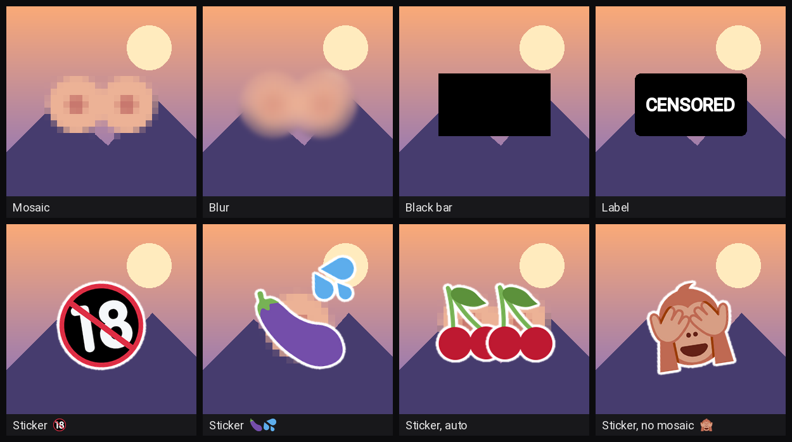

# Peekaboo 🙈

*Now you see it, now you don't.*

Peekaboo is an adult-image workflow extension for **Forge, reForge and Forge Neo**. It detects exposed body parts with [NudeNet](https://github.com/notAI-tech/NudeNet) and offers two independent tools:

- **Peekaboo Refine** redraws detected areas with an inpainting pass, similar in purpose to face-detailing tools.
- **Peekaboo Censor** covers detected areas with a mosaic, blur, black bar, label or sticker.

## Quick use

- **Refine only:** enable **Peekaboo Refine**, choose an **Image style**, then generate.
- **Censor only:** choose **Peekaboo Censor** in the **Script** dropdown, then select an image style and censor style.
- **Both:** enable Refine and choose Censor. The image is refined first, then censored. **Keep the uncensored image too** lets you retain the refined version alongside the censored result.

The image-style presets are **Photo**, **Semi-real** and **Anime & cartoon**. They provide starting values for detection and, when Refine is enabled, for the inpainting pass. The values can be changed under **Fine-tuning**.

## Detection models

The detector downloads on first use into `models/nudenet`: about 12 MB for **320n** and about 100 MB for **640m**. The extension checks downloads before use and can retry an incomplete or invalid file. If the larger model cannot be obtained, it falls back to 320n and reports the model used in the generation information. You can also download [640m.onnx](https://github.com/notAI-tech/NudeNet/releases/download/v3.4-weights/640m.onnx) and place it in `models/nudenet`.

NudeNet was trained mainly on photographs. Anime, cartoon and highly stylized images can be harder to detect reliably. **Censoring is not guaranteed to catch every exposed area**: inspect the resulting image before sharing it or relying on it as a content-safety measure.

## Processing order

Refine runs after the WebUI's face and hand detailers, while Censor runs on the finished image after subsequent post-processing and upscaling. This means the censored output includes later colour grading and upscaling. Files that another extension saves independently before Peekaboo Censor runs are outside its control and may remain uncensored.

Censor is a selectable Script and therefore cannot be combined with another Script such as X/Y/Z plot in the same generation. Refine is an always-on script and can be used with X/Y/Z plot.

## Detailed settings

The complete reference covers processing order, how areas are refined or covered, image-style values, detection settings, saving behaviour and API arguments:

**[Read the detailed settings and implementation notes](docs/DETAILS.md)**

## Credits and licence

Detection uses [NudeNet](https://github.com/notAI-tech/NudeNet) by notAI-tech; the model is downloaded separately. The stickers use [Twemoji](https://github.com/twitter/twemoji) under CC BY 4.0. See `NOTICE.md` for attribution and licence details.
